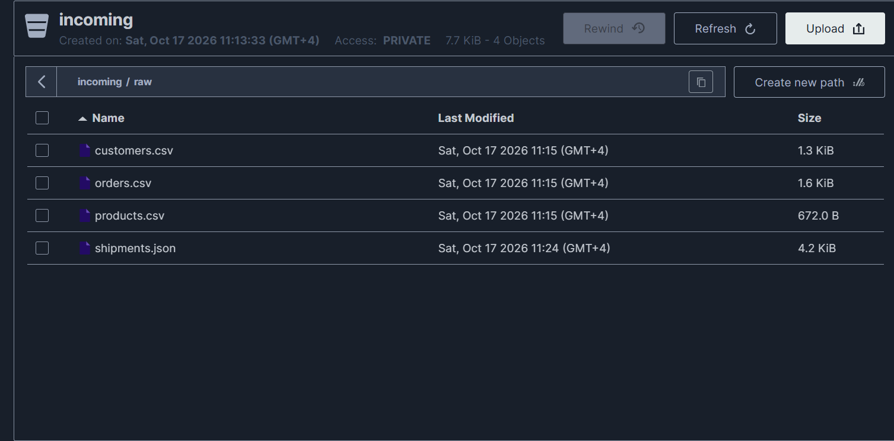
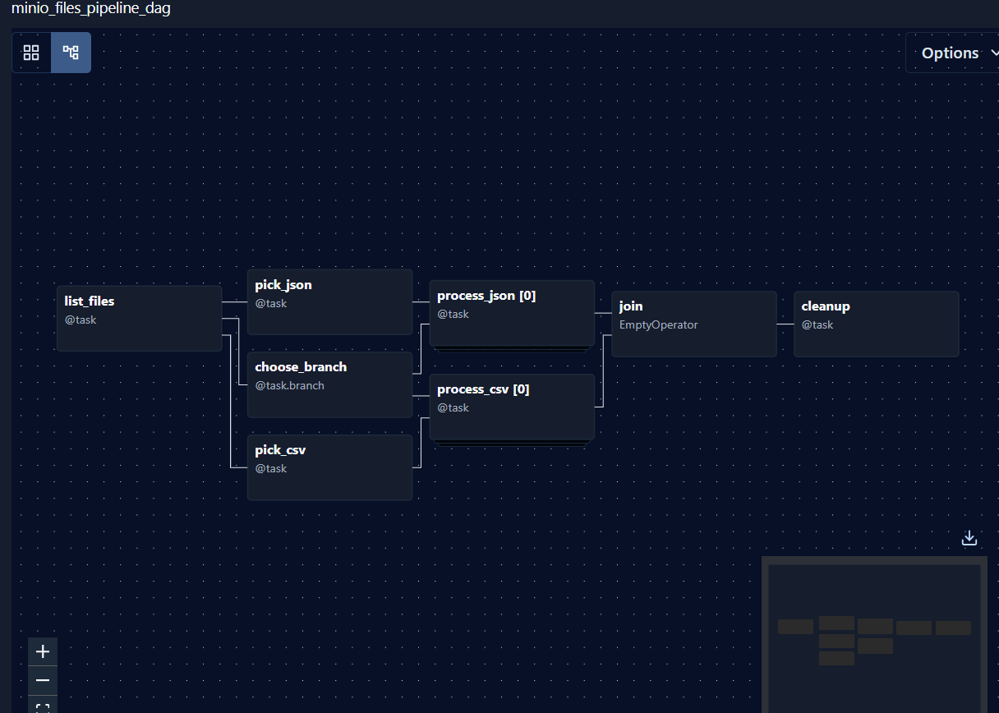
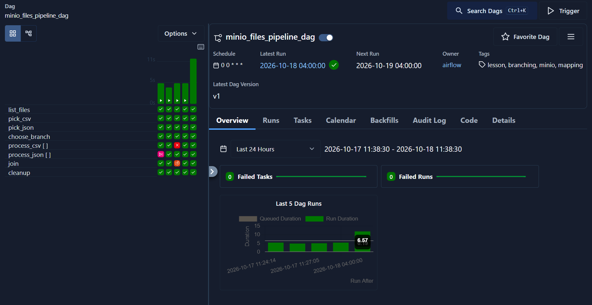
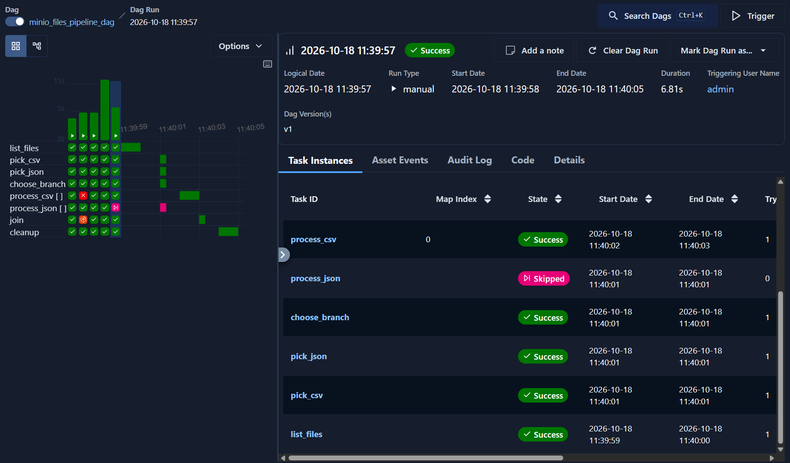
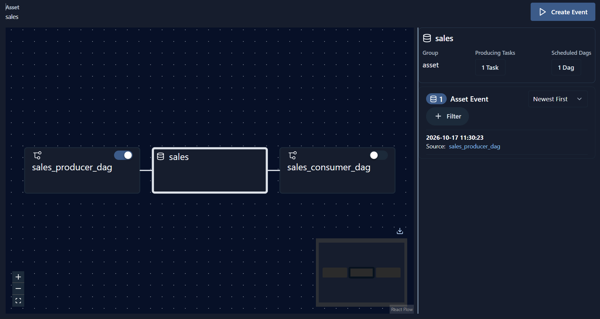
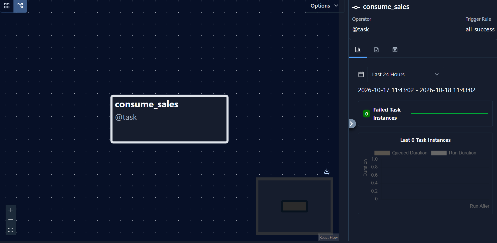
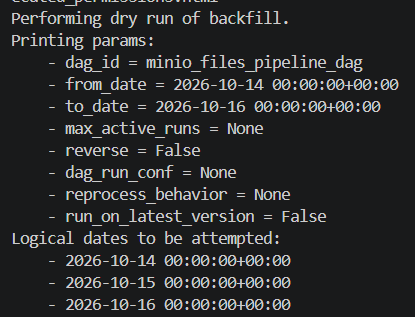
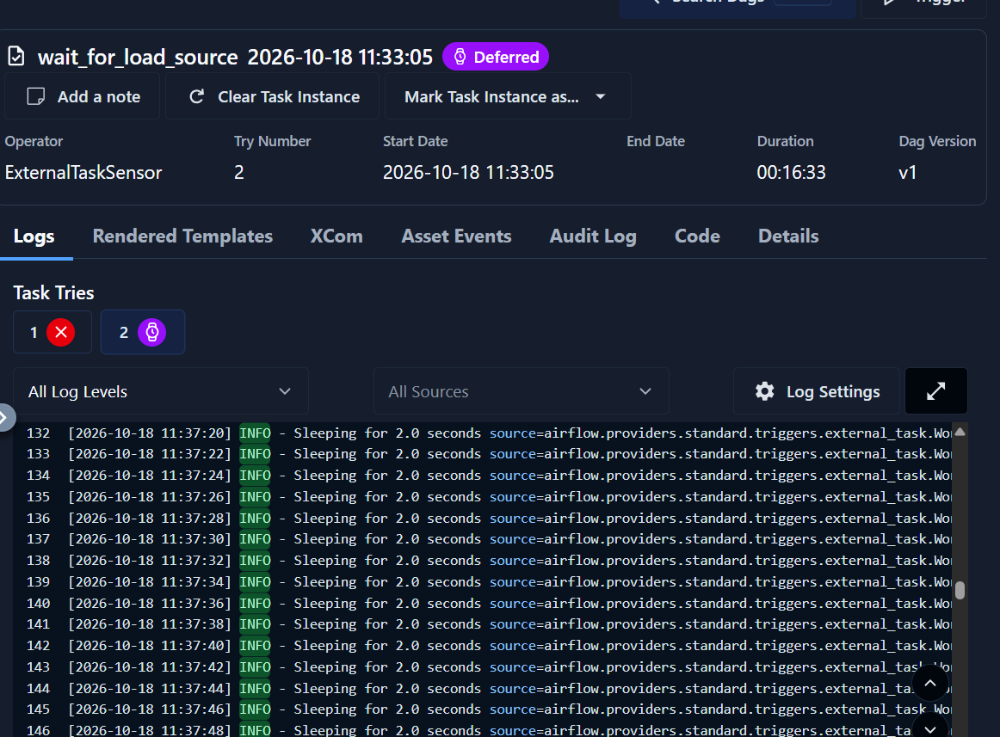
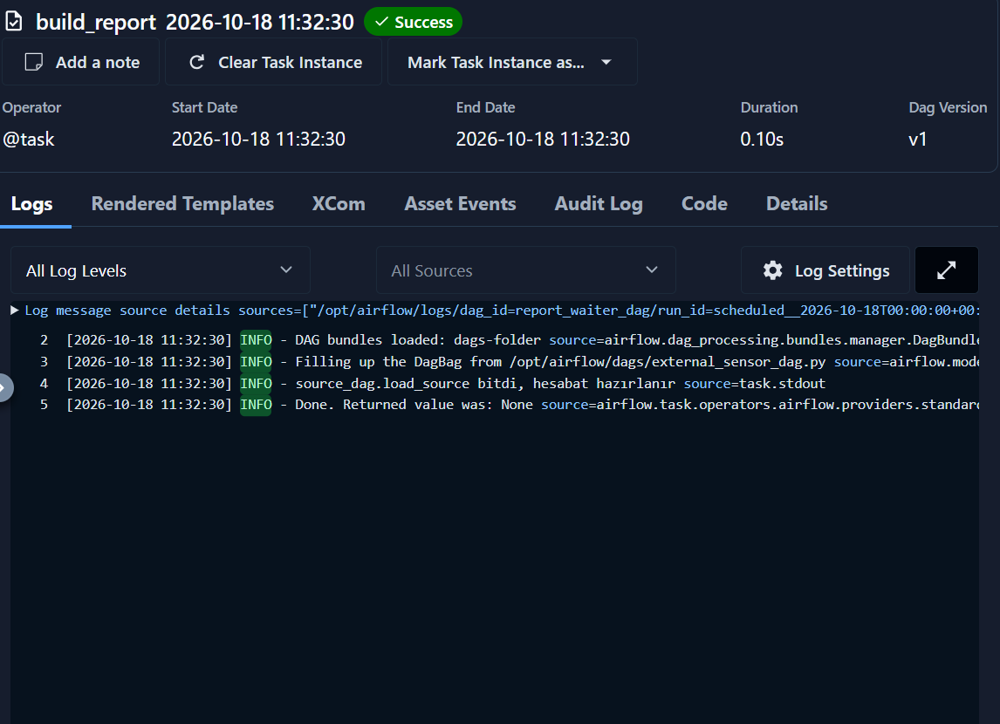
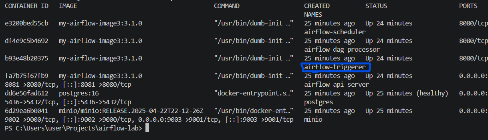

# Airflow: MinIO, Dynamic Mapping, Branching, Asset və Sensor tapşırıqları

Bu sənəd `airflow-lab` layihəsində Airflow 3.1 üzərində hazırlanmış 7 tapşırığı və onların nəzəri izahlarını əhatə edir.
Mühit Docker Compose ilə qurulub: Postgres, MinIO, Airflow `api-server`, `scheduler`, `dag-processor` və `triggerer`.

## Mündəricat

1. [DAG-lar və fayllar](#dag-lar-və-fayllar)
2. [Mühitin qurulması](#mühitin-qurulması)
3. [Tapşırıq 1: Fayl siyahısı və Dynamic Task Mapping](#tapşırıq-1-fayl-siyahısı-və-dynamic-task-mapping)
4. [Tapşırıq 2: CSV / JSON branching](#tapşırıq-2-csv--json-branching)
5. [Tapşırıq 3: Trigger rule-lar](#tapşırıq-3-trigger-rulelar)
6. [Tapşırıq 4: Asset (producer / consumer)](#tapşırıq-4-asset-producer--consumer)
7. [Tapşırıq 5: catchup qərarı və backfill planı](#tapşırıq-5-catchup-qərarı-və-backfill-planı)
8. [Tapşırıq 6: ExternalTaskSensor](#tapşırıq-6-externaltasksensor)
9. [Tapşırıq 7: Deferrable rejim və Triggerer](#tapşırıq-7-deferrable-rejim-və-triggerer)
10. [Qısa nəzəri suallar](#qısa-nəzəri-suallar)
11. [Ən çox rast gəlinən xətalar](#ən-çox-rast-gəlinən-xətalar)

## DAG-lar və fayllar

| DAG | Fayl | Tapşırıq |
|---|---|---|
| `minio_files_pipeline_dag` | `airflow/dags/minio_files_pipeline_dag.py` | 1, 2, 3 |
| `sales_producer_dag`, `sales_consumer_dag` | `airflow/dags/sales_assets_dag.py` | 4 |
| `source_dag`, `report_waiter_dag` | `airflow/dags/external_sensor_dag.py` | 6, 7 |

Tapşırıq 5 (catchup və backfill) kod deyil, qərar və plandır, aşağıda izah olunub.

## Mühitin qurulması

1. `.env` faylı yarat. Şifrələr Git-ə getmir (`.gitignore`-dadır). Lazım olan dəyişənlər: `AIRFLOW_IMAGE_NAME`, `AIRFLOW_UID`, `AIRFLOW__CORE__EXECUTOR`, `AIRFLOW__DATABASE__SQL_ALCHEMY_CONN`, `AIRFLOW__CORE__FERNET_KEY`, `AIRFLOW__CORE__AUTH_MANAGER`, `AIRFLOW__CORE__EXECUTION_API_SERVER_URL`, `AIRFLOW__API__SECRET_KEY`, `AIRFLOW__API_AUTH__JWT_SECRET`, `MINIO_ROOT_USER`, `MINIO_ROOT_PASSWORD`, `POSTGRES_USER`, `POSTGRES_PASSWORD`, `POSTGRES_DB`.
2. Image-i qur və servisləri qaldır:
   ```bash
   docker compose build
   docker compose up -d
   docker ps
   ```
   `airflow-triggerer` konteyneri siyahıda olmalıdır.
3. MinIO console (`http://localhost:9003`) → `incoming` bucket-i yarat → içində `raw/` qovluğu → `airflow/files/` qovluğundakı CSV və JSON faylları yüklə.
4. Airflow UI (`http://localhost:8081`) → **Admin → Connections** → yeni connection:
   - Connection Id: `minio_conn`
   - Type: `Amazon Web Services`
   - Login / Password: `.env`-dəki MinIO istifadəçi adı və şifrəsi
   - Extra: `{"endpoint_url": "http://minio:9000", "region_name": "us-east-1"}`
5. DAG-ları toggle ilə aktiv et və icra et.



## Tapşırıq 1: Fayl siyahısı və Dynamic Task Mapping

`list_files` task-ı `minio_conn` connection-ı ilə MinIO-nun `incoming/raw/` yolundakı fayl adlarını siyahı kimi qaytarır.

**Dynamic Task Mapping** task instance-ların sayının DAG yazılanda yox, **icra zamanı**, əvvəlki task-ın nəticəsinə görə müəyyən olunması deməkdir:

```python
csv_proc = process_csv.expand(key=csv_keys)
```

- 3 CSV varsa, `process_csv` üçün 3 ayrı task instance yaranır, hər biri bir faylı emal edir.
- Instance-lar `map index` ilə fərqlənir (`[0]`, `[1]`, `[2]`) və paralel işləyə bilir.
- Fayl sayı dəyişəndə kodu dəyişmək lazım olmur.
- Defolt limit: bir mapped task ən çox 1024 instance yarada bilər (`max_map_length`).




## Tapşırıq 2: CSV / JSON branching

`choose_branch` (`@task.branch`) siyahıya baxıb işə düşəcək budaqların task_id-lərini qaytarır:

| Bucket-də olan fayllar | Seçilən budaqlar |
|---|---|
| Yalnız CSV | `process_csv` |
| Yalnız JSON | `process_json` |
| Hər ikisi | `process_csv` və `process_json` |
| Heç biri | boş siyahı, bütün budaqlar skipped |

Seçilməyən budaq `skipped` vəziyyətinə keçir. Skipped vəziyyəti aşağı task-lara ötürülür, buna görə `join` üçün düzgün trigger rule seçmək vacibdir.



## Tapşırıq 3: Trigger rule-lar

Trigger rule task-ın **upstream task-ların vəziyyətinə görə nə vaxt işləyəcəyini** müəyyən edir.

| Rule | Nə vaxt işləyir |
|---|---|
| `all_success` (defolt) | Bütün upstream-lər success olanda |
| `all_done` | Bütün upstream-lər bitəndə, vəziyyətindən asılı olmayaraq (success, failed, skipped) |
| `none_failed` | Heç bir upstream failed / upstream_failed deyilsə (skipped olar, success məcburi deyil) |
| `none_failed_min_one_success` | Heç biri failed deyilsə **və** ən azı biri success-dirsə |

**Bu DAG-da:**
- `join` → `none_failed_min_one_success`. Budaqlardan biri həmişə skipped olur, ona görə `all_success` işləməzdi. Bu rule skipped budağı qəbul edir, amma ən azı bir budağın uğurlu olmasını tələb edir.
- `cleanup` → `all_done`. Təmizləmə üstündəki task-lar uğursuz olsa belə işləməlidir.

Yoxlama ssenariləri:
- JSON faylı yoxdursa: `process_json` skipped, `join` success, `cleanup` success.
- `process_csv` fail olarsa: `join` upstream_failed, `cleanup` yenə işləyir.

## Tapşırıq 4: Asset (producer / consumer)

**Asset** Airflow-da data-aware scheduling mexanizmidir: DAG vaxt cədvəli əvəzinə datanın yenilənməsinə reaksiya verir.

- **Producer:** `sales_producer_dag.publish_sales` task-ı `outlets=[sales_asset]` ilə `sales` asset-ini yeniləyir.
- **Consumer:** `sales_consumer_dag` `schedule=[sales_asset]` ilə asset event-ini gözləyir və avtomatik başlayır.
- Asset event yalnız producer task-ı **uğurla** bitəndə yaranır. Task fail olarsa və ya skipped olarsa, consumer başlamır.
- İki DAG faylında `Asset`-in `name` və `uri` dəyərləri eyni olmalıdır.

```python
sales_asset = Asset(name="sales", uri="s3://incoming/sales")
```




## Tapşırıq 5: catchup qərarı və backfill planı

### catchup nədir

`catchup=True` olanda scheduler start_date ilə indiki vaxt arasında buraxılmış **hər interval üçün** run yaradır. `catchup=False` olanda yalnız ən son interval işləyir.

### Qərar: `catchup=False`

Səbəblər:
- `minio_files_pipeline_dag` tarixdən asılı deyil, bucket-in **cari vəziyyətini** oxuyur. Keçmiş tarixlər üçün yüzlərlə run eyni faylları təkrar emal edərdi və yeni dəyər verməzdi.
- start_date keçmişdə olanda `True` DAG aktiv olan kimi çoxlu run yaradıb scheduler və MinIO-nu yükləyər.
- Dayanma (downtime) və ya pauza sonrası "run partlayışının" qarşısı alınır.
- Keçmişi emal etmək lazım olanda bunu **nəzarətli backfill** ilə edirik.

`catchup=True` yalnız idempotent və tarixə görə bölünmüş yükləmələrdə məntiqlidir. Məsələn, hər gün üçün ayrı `raw/{{ ds }}/` qovluğu olanda.

### 3 günlük backfill planı (2026-10-14 → 2026-10-16)

1. **Hazırlıq.** DAG aktivdir və import xətası yoxdur. Task-lar idempotentdir (təkrar işləsə nəticəni korlamır). Bu DAG tarixə bölünməyib, ona görə 3 run da eyni faylları görəcək. Tarixə bağlamaq üçün `PREFIX = "raw/{{ ds }}/"` quruluşu lazımdır.
2. **Quru yoxlama.** Heç nə işə salmadan hansı tarixlərin yaranacağını göstərir:
   ```bash
   docker exec airflow-scheduler airflow backfill create \
     --dag-id minio_files_pipeline_dag \
     --from-date 2026-10-14 --to-date 2026-10-16 --dry-run
   ```
3. **Real backfill.** Run-lar ardıcıl getsin deyə `--max-active-runs 1`:
   ```bash
   docker exec airflow-scheduler airflow backfill create \
     --dag-id minio_files_pipeline_dag \
     --from-date 2026-10-14 --to-date 2026-10-16 --max-active-runs 1
   ```
4. **İzləmə.** DAG-ın Runs siyahısında 3 backfill run-ı və Grid-də vəziyyətləri yoxlanılır.
5. **Xəta olarsa.** Səbəb düzəldilir, uğursuz run-ların task-ları **Clear** edilir və ya `--reprocess-behavior failed` ilə backfill təkrarlanır.
6. **Yoxlama.** 3 run success, hər birində `cleanup` işləyib, təkrarlanan və ya çatışmayan nəticə yoxdur.

Backfill UI-dən də mümkündür: DAG səhifəsində **Trigger** düyməsinin açılan menyusu → **Backfill**.



## Tapşırıq 6: ExternalTaskSensor

`report_waiter_dag` içindəki `ExternalTaskSensor` başqa DAG-dakı `source_dag.load_source` task-ının uğurla bitməsini gözləyir. Sonra `build_report` işləyir.

```python
ExternalTaskSensor(
    task_id="wait_for_load_source",
    external_dag_id="source_dag",
    external_task_id="load_source",
    deferrable=True,
)
```

**Əsas qayda: logical date uyğunluğu.** Sensor defolt olaraq digər DAG-ın **eyni logical date-li** run-ını axtarır. Ona görə iki DAG-ın `schedule` və `start_date`-i eynidir. Əl ilə Trigger edəndə logical date-lər fərqli olur və sensor timeout-a qədər gözləyir. Cədvəllər fərqlidirsə, `execution_delta` və ya `execution_date_fn` ilə offset verilir.

Test (eyni tarix üçün backfill):
```bash
docker exec airflow-scheduler airflow backfill create --dag-id report_waiter_dag --from-date 2026-10-15 --to-date 2026-10-15
docker exec airflow-scheduler airflow backfill create --dag-id source_dag --from-date 2026-10-15 --to-date 2026-10-15
```




## Tapşırıq 7: Deferrable rejim və Triggerer

Sensor-un üç işləmə üsulu:

| Rejim | Necə işləyir | Worker slotu |
|---|---|---|
| `poke` (defolt) | Task bütün gözləmə boyu işləyir və dövri yoxlayır | Bütün müddətdə tutulur |
| `reschedule` | Yoxlamalar arasında task dayanır, scheduler yenidən planlaşdırır | Yoxlamalar arasında boşalır |
| `deferrable` | Gözləmə `Trigger`-ə təhvil verilir, task `deferred` olur | Gözləmə zamanı **tutulmur** |

**Triggerer nədir.** Trigger-lər `asyncio` ilə yazılmış asinxron koddur və yalnız ayrıca **triggerer** prosesi onları icra edir. Bir triggerer eyni anda çoxlu trigger-i bir event loop-da idarə edə bilir.

**Triggerer tələbi.** Triggerer işləmirsə, deferrable task xəta vermir, sadəcə **sonsuza qədər `deferred` qalır**. Ona görə `docker-compose.yaml`-a `airflow-triggerer` servisi (`command: triggerer`) əlavə olunub.

Yoxlama:
```bash
docker ps --filter name=triggerer
docker logs airflow-triggerer --tail 20
```

**Nə vaxt uyğundur.** Uzun və qeyri-müəyyən gözləmələrdə (başqa DAG, S3/MinIO faylı, xarici sistem) və çoxlu paralel sensor olanda. Bir neçə saniyəlik gözləmələrdə adi `poke` kifayətdir. Bütün sensor və operatorları defolt deferrable etmək üçün: `AIRFLOW__OPERATORS__DEFAULT_DEFERRABLE=True`.



## Qısa nəzəri suallar

**Mapped task-ların sayı nə vaxt bəlli olur?** İcra zamanı, `expand()`-a verilən upstream nəticəsi hazır olanda.

**Skipped budaq `join`-i niyə bloklamır?** Çünki `join` `none_failed_min_one_success` istifadə edir: skipped olanlara dözür, yalnız failed upstream-ə və success-in tamamilə olmamasına dözmür.

**`all_done` ilə `none_failed` fərqi nədir?** `all_done` failed upstream olsa da işləyir. `none_failed` isə upstream failed olanda işləmir.

**Asset event nə vaxt yaranır?** Producer task-ı uğurla bitəndə. Fail və ya skipped olanda yaranmır.

**Niyə `catchup=False` seçdik?** DAG cari vəziyyəti oxuyur, keçmiş tarixlər üçün run-lar eyni nəticəni verərdi. Lazım olanda nəzarətli backfill edilir.

**ExternalTaskSensor niyə sonsuz gözləyə bilər?** Digər DAG-ın eyni logical date-li run-ı yoxdursa (məsələn əl ilə trigger olunub) və ya o task heç vaxt success olmursa. `timeout` bunu məhdudlaşdırır.

**Deferrable nə vaxt işləməz?** Triggerer işləmirsə. Task `deferred` vəziyyətində ilişib qalır.

## Ən çox rast gəlinən xətalar

| Xəta | Səbəb |
|---|---|
| `No module named 'airflow.providers.amazon'` | `docker compose build` edilməyib |
| `The conn_id 'minio_conn' isn't defined` | Connection yaradılmayıb və ya adı fərqlidir |
| `NoSuchBucket` | `incoming` bucket-i yoxdur və ya adı fərqlidir |
| `Could not connect to the endpoint URL` | Extra-da `endpoint_url` `http://minio:9000` olmalıdır |
| DAG siyahıda görünmür | `docker logs airflow-dag-processor --tail 50` ilə import xətasına bax |
| Sensor həmişə `deferred` qalır | Triggerer işləmir və ya logical date-lər uyğun gəlmir |
